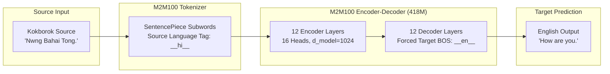

# Kokborok–English Neural Machine Translation
### *Low-Resource Neural Machine Translation for Indigenous Language Preservation*

[](https://www.python.org/)
[](https://pytorch.org/)
[](https://huggingface.co/facebook/m2m100_418M)
[](https://doi.org/10.1201/9781003743767-121)
[](https://www.taylorfrancis.com/chapters/edit/10.1201/9781003743767-121/developing-neural-machine-translation-tool-kokborok-english-step-toward-preserving-indigenous-languages-sanchali-das-pranjal-mainak-sarkar)
[](https://github.com/Pranjal099/kokborok-english-neural-machine-translation)

---

## Published Research Paper

This repository contains the official implementation, preprocessing pipeline, model architecture, training configurations, and evaluation benchmarks for the research paper:

> **Developing Neural Machine Translation Tool: Kokborok–English, a Step Toward Preserving Indigenous Languages**  
> **Authors:** Sanchali Das, Pranjal, and Mainak Sarkar  
> **Publication:** *Sustainable Developments in Computer Engineering, Green Technology and Smart Systems*  
> **Publisher:** CRC Press / Taylor & Francis Group (2026)  
> **Pages:** 767–775  
> **DOI:** [10.1201/9781003743767-121](https://doi.org/10.1201/9781003743767-121)  
> **Publication Chapter Link:** [Taylor & Francis Online](https://www.taylorfrancis.com/chapters/edit/10.1201/9781003743767-121/developing-neural-machine-translation-tool-kokborok-english-step-toward-preserving-indigenous-languages-sanchali-das-pranjal-mainak-sarkar)

---

## Table of Contents
1. [Overview](#overview)
2. [Research Motivation](#research-motivation)
3. [Model Architecture](#model-architecture)
4. [Dataset & Data Availability](#dataset--data-availability)
5. [Data Preprocessing Pipeline](#data-preprocessing-pipeline)
6. [Tokenization](#tokenization)
7. [Training Methodology & Hardware](#training-methodology--hardware)
8. [Evaluation Metrics & Protocol](#evaluation-metrics--protocol)
9. [Experimental Results & Benchmark Comparison](#experimental-results--benchmark-comparison)
10. [Published Translation Examples](#published-translation-examples)
11. [Repository Structure](#repository-structure)
12. [Installation & Setup](#installation--setup)
13. [Inference & Usage](#inference--usage)
14. [Training Instructions](#training-instructions)
15. [Limitations](#limitations)
16. [Future Work](#future-work)
17. [Citation](#citation)
18. [Contact & Inquiries](#contact--inquiries)

---

## Overview

Kokborok (ISO 639-3: `trp`) is a Sino-Tibetan (Tibeto-Burman) language spoken primarily by the Tripuri community in the state of Tripura in Northeastern India and surrounding regions. Despite its rich cultural heritage and constitutional recognition, Kokborok is severely digitally under-resourced in Natural Language Processing (NLP), with minimal computational corpora, no standardized digital treebanks, and significant orthographic variation across Latin and Bengali scripts.

This project addresses this technological divide by developing an end-to-end Neural Machine Translation (NMT) system for the **Kokborok $\leftrightarrow$ English** language pair. By leveraging multilingual transfer learning from Meta’s **M2M100 (418M)** Transformer model, the system circumvents the failure modes of training small models from scratch, reaching a competitive **70.56 BLEU score** on held-out evaluation pairs.

---

## Research Motivation

Machine translation for major world languages has seen monumental progress through deep transformer architectures. However, indigenous and regional languages frequently face a severe bottleneck:
- **Scarcity of Parallel Data:** Unlike high-resource language pairs with millions of sentence pairs, Kokborok material is scattered across printed booklets, religious texts, and isolated word lists.
- **Inconsistent Orthography:** Kokborok is written in both the Latin alphabet and the Bengali-Assamese script, with non-standardized phonetic spelling conventions that complicate tokenization.
- **Absence of Dedicated Pretrained Embeddings:** Mainstream multilingual foundation models do not include a dedicated language code for Kokborok.

Preserving Kokborok computationally is critical for educational access, administrative inclusion, cultural documentation, and safeguarding indigenous linguistic identity in modern digital ecosystems.

---

## Model Architecture

The core translation system is powered by **M2M100 (418M parameters)** (`facebook/m2m100_418M`), a multilingual sequence-to-sequence Transformer designed for direct translation across 100 languages without relying on English as an intermediate pivot.



### Key Architectural Characteristics:
- **Encoder-Decoder Backbone:** 12 Transformer encoder layers and 12 Transformer decoder layers.
- **Attention Mechanism:** 16 attention heads with hidden representation dimension $d_{\text{model}} = 1024$ and feed-forward dimension $d_{\text{ff}} = 4096$.
- **Multilingual Transfer:** Cross-lingual representations are transferred by anchoring the Kokborok source text to the `hi` (Hindi) language token in the pretrained multilingual vocabulary, allowing the model to project Kokborok syntax into a well-conditioned contextual embedding space.

---

## Dataset & Data Availability

### Parallel Corpus Compilation
Because no pre-existing unified digital parallel corpus existed, data was compiled from multiple sources:
1. **Kokborok Bible Corpus (`KOKBSI`):** Bilingual verse alignments scraped from the Kokborok Bible Society of India with parallel English text (~30,000+ aligned verses).
2. **TTAADC Learning Booklet:** The *Learn Kokborok Language* guide published by the Tripura Tribal Areas Autonomous District Council, digitized via OCR (`EasyOCR`).
3. **Public Hugging Face Corpora:** Cleaned topic sentences and paragraph pairs extracted from `smoldoc__en_trp.json`.
4. **Curated Conversational Pairs:** Manually checked conversational sentences added to improve modern day-to-day phraseology.

### Data Availability & Access Request
> **IMPORTANT NOTICE:**  
> The compiled Kokborok–English parallel dataset is a proprietary research asset and **is NOT publicly hosted or distributed through this GitHub repository**.  
>  
> For academic research inquiries, dataset verification, or collaboration requests, please contact the author directly:  
> **Email:** [pranjalofficial32@gmail.com](mailto:pranjalofficial32@gmail.com)

---

## Data Preprocessing Pipeline

The preprocessing workflow is implemented in `src/preprocessing/clean_and_merge.py`:
- **Text Normalization:** Lowercasing, Unicode whitespace collapse, and strip formatting.
- **Punctuation & Noise Cleaning:** Removal of leading verse numbers, non-standard quotes (e.g., `„`, `”`, `’`), and encoding artifacts.
- **Deduplication:** Filtering redundant identical sentence pairs across multi-source extractions.
- **Length Constraint Filtering:** Mandatory enforcement of a full-sentence threshold requiring strictly more than 2 tokens per side, eliminating isolated words and OCR artifacts.
- **Final Cleaned Dataset:** **37,241 parallel sentence pairs** split 80% for training, 10% for validation, and 10% for testing.

---

## Tokenization

Tokenization is managed via SentencePiece subword tokenization:
- **Subword Segmentation:** Rare and agglutinative Kokborok terms are broken into subword units, avoiding out-of-vocabulary (OOV) tokens.
- **Sequence Truncation & Padding:** Fixed maximum sequence length of **64 tokens** with padding to `max_length`.
- **Pretrained Multilingual Vocabulary:** Shared vocabulary of 128,112 subwords in the M2M100 tokenizer.

---

## Training Methodology & Hardware

Training was conducted using **PyTorch** and Hugging Face Transformers `Trainer` API on **Google Colab Pro** equipped with **NVIDIA L4 and A100 Tensor Core GPUs**.

| Hyperparameter | Value | Description |
| :--- | :--- | :--- |
| **Model** | `facebook/m2m100_418M` | Multilingual sequence-to-sequence Transformer |
| **Optimizer** | `AdamW` | Decoupled weight decay regularization |
| **Learning Rate** | `5e-5` | Constant learning rate with linear warmup |
| **Batch Size** | `32` | Effective per-device batch size |
| **Training Epochs** | `12` | Full training iterations over the corpus |
| **Weight Decay** | `0.01` | L2 penalty coefficient |
| **Max Sequence Length** | `64` | Truncation and padding token limit |
| **Precision** | `FP16` (Mixed Precision) | Accelerated GPU tensor core execution |
| **Logging Steps** | `500` | Intermediate loss and step reporting |
| **Saving Strategy** | Every Epoch | Checkpointing per epoch |
| **Total Wall-Clock Time** | `10,047 seconds` (~2.79 hrs) | Training convergence duration |

---

## Evaluation Metrics & Protocol

Evaluation was performed on a held-out test split of 100 representative Kokborok sentences:
- **BLEU (SacreBLEU):** Computes geometric mean of modified n-gram precisions multiplied by a brevity penalty.
- **METEOR:** Evaluates harmonic mean of precision and recall incorporating unigram matching, stemming, and synonymy.
- **ROUGE-L:** Measures longest common subsequence (LCS) to assess sentence-level structure retention.

---

## Experimental Results & Benchmark Comparison

### Quantitative Benchmark
The fine-tuned M2M100 model achieved outstanding quantitative results, significantly outperforming classical baselines:

| Architecture | Training Strategy | BLEU Score | METEOR | ROUGE-L |
| :--- | :--- | :--- | :--- | :--- |
| **Seq2Seq (RNN + Attention)** | From Scratch | 5 – 8 | — | — |
| **Transformer (Base)** | From Scratch | 9 – 13 | — | — |
| **M2M100 (Fine-Tuned)** | **Multilingual Transfer Learning** | **70.56** | **0.76 (76%)** | **0.80 (80%)** |

### Loss Convergence Trajectory
- **Step 500:** Loss = `1.81`
- **Step 5,000:** Loss = `0.84`
- **Final Steps:** Loss $\approx$ `0.27`

Convergence was smooth and steady across all 12 epochs without signs of catastrophic forgetting or overfitting.

---

## Published Translation Examples

Representative qualitative translations verified from Table 3 of the published paper:

| # | Kokborok Source Sentence | Model Generated Translation | Reference Translation | Domain |
| :-: | :--- | :--- | :--- | :--- |
| **1** | `yaphango kaitor nokharok tei hayungno snam kha.` | `in the beginning god created the heavens and the earth.` | `in the beginning god created the heavens and the earth.` | Scripture |
| **2** | `Nwng Bahai Tong.` | `How are you.` | `How are you.` | Conversational |
| **3** | `Ang kahamno` | `i am well` | `I am well.` | Conversational |
| **4** | `hakhe hor wngwi phung ai kha tei salthamni sal wng kha.` | `and the evening and the morning were the third day.` | `and the evening and the morning were the third day.` | Scripture |

---

## Repository Structure

```text
kokborok-english-neural-machine-translation/
├── README.md                               # Project documentation & published paper overview
├── CITATION.cff                            # Academic citation metadata (CFF 1.2.0)
├── requirements.txt                        # Python dependencies
├── .gitignore                              # Comprehensive dataset & security exclusions
│
├── src/                                    # Modular source code
│   ├── __init__.py
│   ├── preprocessing/                      # Corpus curation & cleaning
│   │   ├── __init__.py
│   │   ├── clean_and_merge.py              # Deduplication, filtering & merging pipeline
│   │   ├── dataset_stats.py                # Corpus length & vocabulary statistics
│   │   ├── extract_parallel.py             # OCR extraction for scanned booklet material
│   │   ├── bible_scraper.py                # Selenium scraper for bilingual scripture
│   │   ├── smoldoc_kok_eng.py              # Hugging Face sentence pair parser
│   │   ├── solnsent_kok_eng.py             # Hugging Face paragraph parser
│   │   ├── smoldoc_words.py                # Hugging Face dataset converter
│   │   └── lexicon_extractor.py            # Dictionary word-pair extractor
│   ├── tokenization/                       # Tokenizer training & batch encoding
│   │   ├── __init__.py
│   │   ├── train_spm_tokenizer.py          # SentencePiece BPE tokenizer trainer
│   │   ├── spm_encode_example.py           # Tokenizer inspection & encoding demo
│   │   └── tokenize_corpus.py              # Batch corpus tokenization utility
│   ├── training/                           # Model fine-tuning
│   │   ├── __init__.py
│   │   └── train_m2m100.py                 # M2M100 fine-tuning implementation
│   ├── evaluation/                         # Benchmarking & metrics
│   │   ├── __init__.py
│   │   └── evaluate_metrics.py             # SacreBLEU, METEOR, and ROUGE-L evaluator
│   └── inference/                          # Translation inference
│       ├── __init__.py
│       └── translate.py                    # Interactive CLI & batch translator
│
├── notebooks/                              # Jupyter / Google Colab research notebooks
│   ├── 01_kokborok_m2m100_training.ipynb   # Complete Colab Pro fine-tuning workflow
│   ├── 02_kokborok_m2m100_evaluation.ipynb # SacreBLEU / METEOR evaluation notebook
│   └── 03_transformer_from_scratch_baseline.ipynb # PyTorch Transformer baseline
│
├── docs/                                   # Detailed documentation
│   └── project_documentation.md            # Extended architectural & theoretical guide
│
└── results/                                # Experimental records
    └── README.md                           # Quantitative scores, baselines & sample analysis
```

---

## Installation & Setup

### 1. Clone the Repository
```bash
git clone https://github.com/Pranjal099/kokborok-english-neural-machine-translation.git
cd kokborok-english-neural-machine-translation
```

### 2. Create Virtual Environment
```bash
python3 -m venv .venv
source .venv/bin/activate  # On Windows: .venv\Scripts\activate
```

### 3. Install Dependencies
```bash
pip install --upgrade pip
pip install -r requirements.txt
```

---

## Inference & Usage

### Interactive Translation Session
Translate Kokborok text interactively via terminal:
```bash
python -m src.inference.translate --interactive
```

### Single Sentence Translation
```bash
python -m src.inference.translate --text "Nwng Bahai Tong."
# Output: How are you.
```

### Python API Usage
```python
from src.inference.translate import KokborokTranslator

translator = KokborokTranslator(model_path_or_name="facebook/m2m100_418M")
translation = translator.translate("Nwng Bahai Tong.")
print(translation)  # How are you.
```

### Metric Evaluation Demo
Run the benchmark evaluator on verified paper examples:
```bash
python -m src.evaluation.evaluate_metrics --demo
```

---

## Training Instructions

To reproduce model training on Google Colab Pro or a local GPU machine:

1. **Open Colab Notebook:** Run [`notebooks/01_kokborok_m2m100_training.ipynb`](notebooks/01_kokborok_m2m100_training.ipynb) on an NVIDIA L4 or A100 GPU runtime.
2. **Or run via CLI:**
```bash
python -m src.training.train_m2m100 \
    --data-path kokborok_full_sentences.csv \
    --output-dir ./m2m100_finetuned \
    --lr 5e-5 \
    --batch-size 32 \
    --epochs 12 \
    --max-length 64
```

---

## Limitations

1. **Domain Bias:** A substantial portion of the parallel corpus originates from biblical scripture, leading to exceptional performance on formal and religious registers, with moderate generalization to modern colloquial youth slang.
2. **Orthographic Inconsistency:** Multiple competing spelling conventions exist in Kokborok, occasionally causing subword fragmentation.
3. **Sequence Length Limit:** Sentences longer than 64 subword tokens are truncated during training.

---

## Future Work

- **Corpus Expansion:** Incorporating contemporary conversational dialogues, news articles, and administrative textbooks.
- **Larger Pretrained Models:** Fine-tuning multilingual foundation models such as NLLB-200 (No Language Left Behind) and IndicTrans2.
- **Web Interface:** Deploying an open-access web translation portal and REST API to assist Kokborok language learners and educators.

---

## Citation

If you use this codebase, methodology, or experimental findings in your research, please cite our published paper:

```bibtex
@incollection{das2026kokborok,
  author    = {Das, Sanchali and Gautam, Pranjal and Sarkar, Mainak},
  title     = {Developing Neural Machine Translation Tool: Kokborok--English, a Step Toward Preserving Indigenous Languages},
  booktitle = {Sustainable Developments in Computer Engineering, Green Technology and Smart Systems},
  publisher = {CRC Press},
  year      = {2026},
  month     = {July},
  pages     = {767--775},
  doi       = {10.1201/9781003743767-121},
  url       = {https://www.taylorfrancis.com/chapters/edit/10.1201/9781003743767-121/developing-neural-machine-translation-tool-kokborok-english-step-toward-preserving-indigenous-languages-sanchali-das-pranjal-mainak-sarkar}
}
```

Citation metadata is also available in machine-readable [`CITATION.cff`](CITATION.cff) format.

---

## Contact & Inquiries

For questions regarding the paper, model reproduction, or dataset access requests:
- **Author:** Pranjal Gautam
- **Email:** [pranjalofficial32@gmail.com](mailto:pranjalofficial32@gmail.com)
- **GitHub:** [@Pranjal099](https://github.com/Pranjal099)
- **Repository:** [kokborok-english-neural-machine-translation](https://github.com/Pranjal099/kokborok-english-neural-machine-translation)
