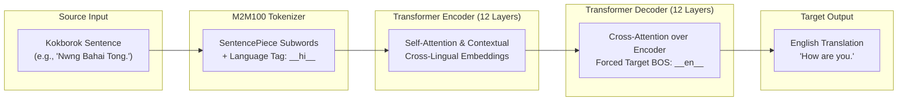

# Project Documentation: Kokborok–English Neural Machine Translation

## 1. Executive Summary & Research Context

Kokborok (ISO 639-3: `trp`) is a Tibeto-Burman language spoken predominantly by the Tripuri indigenous community in the northeastern Indian state of Tripura and adjacent border areas. Despite its constitutional status and cultural importance, Kokborok remains digitally under-resourced in Natural Language Processing (NLP), with minimal computational corpora, absence of standard treebanks, and non-standardized orthography across digital media.

This repository documents the research and implementation of the paper:
> **"Developing Neural Machine Translation Tool: Kokborok–English, a Step Toward Preserving Indigenous Languages"**  
> *Sanchali Das, Pranjal, and Mainak Sarkar*  
> Published in: *Sustainable Developments in Computer Engineering, Green Technology and Smart Systems*, CRC Press / Taylor & Francis Group, 2026.  
> DOI: [10.1201/9781003743767-121](https://doi.org/10.1201/9781003743767-121) | Pages: 767–775

The primary objective of this work is to bridge the digital linguistic divide for Kokborok through transfer learning with multilingual Transformer architectures, enabling high-quality bidirectional Kokborok $\leftrightarrow$ English machine translation.

---

## 2. Parallel Corpus Engineering & Curation

### 2.1 Data Sources
Because single large-scale parallel corpora do not exist for Kokborok, training data was aggregated across multiple primary sources:

1. **Kokborok–English Bible Corpus (`KOKBSI`):**
   - Scraped from the Kokborok Bible Society of India with parallel English alignments via `src/preprocessing/bible_scraper.py`.
   - Provides extensive grammatical structures and vocabulary (~30,000+ aligned verses).
2. **TTAADC Learning Guide ("Learn Kokborok Language"):**
   - Published by the Tripura Tribal Areas Autonomous District Council (TTAADC).
   - Extracted using Optical Character Recognition (`EasyOCR`) via `src/preprocessing/extract_parallel.py` to capture contemporary conversational phrases and grammatical primers.
3. **Publicly Available Hugging Face Corpora (`sdmy/kokborok`):**
   - Cleaned parallel sentences and topic paragraphs extracted from `smoldoc__en_trp.json` using `src/preprocessing/smoldoc_kok_eng.py` and `src/preprocessing/solnsent_kok_eng.py`.
4. **Manual Translations & Conversational Samples:**
   - Native speaker translations and everyday conversational expressions curated to diversify domain coverage beyond religious texts.

### 2.2 Data Preprocessing & Cleaning Pipeline
Data preprocessing was implemented in `src/preprocessing/clean_and_merge.py`:
- **Text Normalization:** Lowercasing, Unicode whitespace collapse, and strip formatting.
- **Noise & Artifact Removal:** Removal of leading verse numbers, non-standard punctuation marks (e.g., `„`, `”`, `’`), and broken encoding artifacts (``).
- **Deduplication:** Removal of duplicate sentence pairs across disparate collection sources.
- **Length Filtering:** Enforcing a full-sentence threshold requiring strictly more than 2 words on both Kokborok and English sides to eliminate isolated fragments and OCR noise.
- **Final Corpus Size:** **37,241** high-quality parallel sentence pairs.

### 2.3 Dataset Privacy Policy
The compiled dataset is a specialized research asset. To preserve data integrity and prevent unauthorized distribution:
- **The dataset is NOT hosted publicly in this repository.**
- Legitimate academic researchers wishing to reproduce or build upon this corpus may request access by emailing:
  **`pranjalofficial32@gmail.com`**

---

## 3. Model Architecture & Multilingual Transfer Learning

### 3.1 Why From-Scratch Baselines Underperform
Training standard sequence-to-sequence models (such as RNNs with Attention or standard Transformer Base) from scratch on small corpora (sub-50k sentence pairs) typically leads to severe overfitting, attention collapse, and poor generalization (achieving BLEU scores between 5 and 13).

### 3.2 Meta's M2M100 (418M)
To overcome data scarcity, this work employs Meta's **M2M100 (418M parameters)** (`facebook/m2m100_418M`). M2M100 is a multilingual encoder-decoder Transformer trained directly on 100 languages without routing through English:
- **Encoder:** 12 Transformer layers, 16 attention heads, hidden dimension $d_{\text{model}} = 1024$, feed-forward dimension $d_{\text{ff}} = 4096$.
- **Decoder:** 12 Transformer layers, 16 attention heads, hidden dimension $d_{\text{model}} = 1024$, feed-forward dimension $d_{\text{ff}} = 4096$.
- **Subword Tokenization:** SentencePiece BPE tokenizer with a shared multilingual vocabulary of 128,112 subword tokens.



### 3.3 Transfer Learning Mechanics
Because Kokborok does not have its own dedicated language token tag in the original 100 M2M100 languages, the source language was configured to `hi` (Hindi), acting as an anchor in the multilingual representation space. This enables the model to leverage cross-lingual representations learned from typologically related and regional languages during pretraining.

---

## 4. Training Configuration & Hyperparameters

The model was fine-tuned using PyTorch and Hugging Face Transformers `Trainer` on **Google Colab Pro** equipped with **NVIDIA L4 and A100 Tensor Core GPUs**.

| Hyperparameter | Value | Description |
| :--- | :--- | :--- |
| **Base Model** | `facebook/m2m100_418M` | 418M parameter multilingual Transformer |
| **Optimizer** | `AdamW` | Decoupled weight decay optimizer |
| **Learning Rate** | `5e-5` | Constant / linear decay learning rate |
| **Batch Size** | `32` | Effective per-device batch size |
| **Epochs** | `12` | Full training passes over the corpus |
| **Weight Decay** | `0.01` | L2 regularization parameter |
| **Max Sequence Length** | `64` | Token truncation and padding threshold |
| **Mixed Precision** | `FP16` | Accelerated mixed-precision training |
| **Loss Function** | Cross-Entropy | Label-smoothed sequence loss |
| **Logging Steps** | `500` | Metric and loss logging interval |
| **Checkpoint Strategy** | Every Epoch | Best model checkpointing |
| **Total Training Time** | ~10,047 seconds | ~2.79 hours on cloud GPU |

### Training Convergence Trajectory
- **Initial Training Loss (Step 500):** $1.81$
- **Final Training Loss (Later Steps):** $\sim 0.27$
- Stable convergence was achieved across all 12 epochs without signs of overfitting, facilitated by pretrained multilingual weights.

---

## 5. Evaluation & Experimental Findings

### 5.1 Quantitative Results
Evaluation was conducted on a held-out test split using standard machine translation metrics:

| Metric | Tool / Implementation | Published Score | Interpretation |
| :--- | :--- | :--- | :--- |
| **BLEU** | `sacrebleu` | **70.56** | High n-gram precision and fluency |
| **METEOR** | `nltk.translate.meteor_score` | **0.76 (76.0%)** | Semantic alignment and synonym matching |
| **ROUGE-L** | `rouge_score` | **0.80 (80.0%)** | Longest Common Subsequence recall |

### 5.2 Comparative Baselines (from Table 2 in Published Paper)

| Model Architecture | Pretraining | BLEU Score | Analysis |
| :--- | :--- | :--- | :--- |
| **Seq2Seq (RNN + Attention)** | None (Trained from scratch) | 5 – 8 | Suffers from vanishing gradients and weak long-range context |
| **Transformer (Base)** | None (Trained from scratch) | 9 – 13 | High capacity leads to severe overfitting on small corpus |
| **M2M100 (Fine-Tuned)** | Multilingual (100 languages) | **70.56** | Cross-lingual transfer overcomes data scarcity |

### 5.3 Published Translation Examples (Table 3 in Paper)

```
[Sample 1 - Biblical Domain]
Source (Kokborok):  yaphango kaitor nokharok tei hayungno snam kha.
Model (English):    in the beginning god created the heavens and the earth.

[Sample 2 - Conversational Domain]
Source (Kokborok):  Nwng Bahai Tong.
Model (English):    How are you.

[Sample 3 - Conversational Domain]
Source (Kokborok):  Ang kahamno
Model (English):    i am well

[Sample 4 - Biblical Domain]
Source (Kokborok):  hakhe hor wngwi phung ai kha tei salthamni sal wng kha.
Model (English):    and the evening and the morning were the third day.
```

---

## 6. Known Limitations & Research Frontiers

1. **Domain Distribution:** The corpus contains a high proportion of religious scripture, which yields exceptional performance on religious texts but creates a domain shift when handling colloquial modern slang.
2. **Orthography Standardization:** Kokborok lacks a single globally standardized spelling convention across Latin and Bengali scripts, leading to occasional phonetic variants for identical words.
3. **Fixed Context Window:** The 64-token maximum sequence length used during training truncates compound complex sentences.
4. **Future Work:**
   - Expansion into conversational social media and administrative corpora.
   - Fine-tuning larger foundation models (e.g., NLLB-200, IndicTrans2, and instruction-tuned LLMs).
   - Public deployment of a bidirectional web translator and interactive API.
